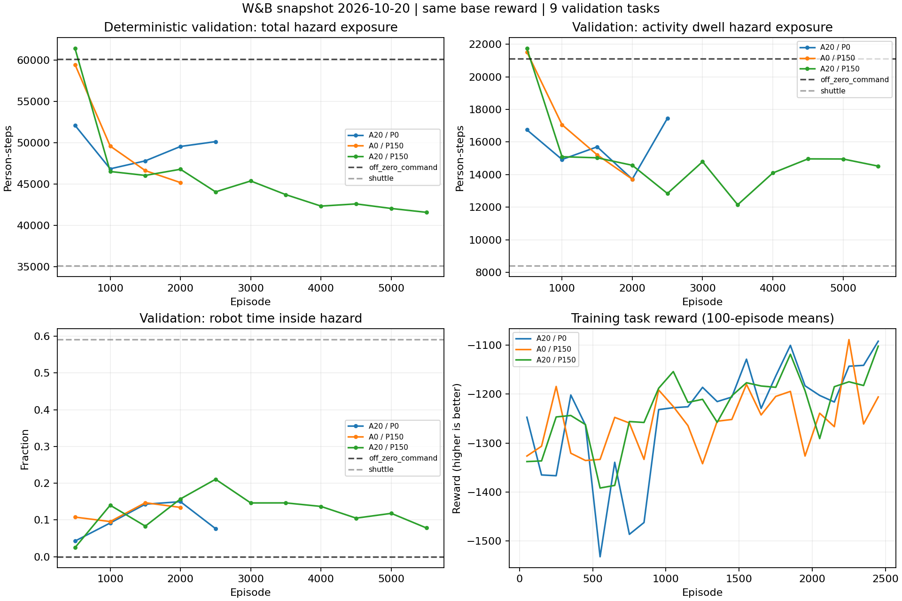

# W&B 학습 분석 — 2026-10-20

**[Certain] 최신 공통 평가인 2,000 episode에서는 Progress 단독(A0/P150)이 가장 좋다. Approach 단독(A20/P0)은 1,000 이후 검증 위험 노출이 증가했다. [Likely] 현재 계속 학습할 우선순위는 Progress 단독이다. 다만 Approach의 불필요성이나 Progress의 독립적인 효과를 확정할 실험은 아직 부족하다.**

## 데이터와 비교 조건

| 실험 | W&B | 상태 | 수집된 마지막 학습 episode | 마지막 완료 검증 |
|---|---|---|---:|---:|
| A20/P0 | [z44h9d77](https://wandb.ai/437snowcap-sungkyunkwan-university/adds-sac-ued6-261011ENV/runs/z44h9d77) | running | 2,542 | 2,500 |
| A0/P150 | [4pr4wxci](https://wandb.ai/437snowcap-sungkyunkwan-university/adds-sac-ued6-261011ENV/runs/4pr4wxci) | running | 2,507 | 2,000 |
| A20/P150 | [vsa06hsg](https://wandb.ai/437snowcap-sungkyunkwan-university/adds-sac-ued6-261011ENV/runs/vsa06hsg) | crashed | 5,930 | 5,500 |

- W&B API scalar history 및 config를 읽어서 저장했다. 실행 중인 run의 수집 시점에 따른 작은 episode 차이는 존재할 수 있다. `crashed`는 W&B 상태이며, 수치 발산이나 종료 원인을 의미한다고 해석하지 않았다.
- 세 run은 모두 fresh start(`run/resumed_episode=0`), person_time=5, remaining_path=0, reentry=0, collision=0.05, CNN/m, UPT=2, learning rate=1e-4, alpha floor=0.05이다. 이전 Approach20 run `d774mrrb`는 기본 보상 구성이 달라 이번 주 비교에서 제외했다.
- 저장된 top-level config상 혼합 대비 A0/P150의 차이는 Approach 가중치와 run 이름이다. A20/P0는 Progress 가중치, run 이름, OSM cache 경로가 다르다. 기록된 두 git commit의 `SAC_UED6_easy` 소스 차이는 training/common.py의 Approach 기본값과 이름이며, 나머지는 이전 분석 문서 및 bytecode이다. 실제 적용 가중치는 각 W&B config를 기준으로 했다.
- A20/P0의 dynamics fingerprint는 cache 경로 차이도 포함하므로, hash 차이를 사람 행동 동역학 변경의 증거로 보지 않았다. 하드웨어 및 실행 환경까지 동일함을 검증한 것은 아니다.
- 평가: 200 m, 로봇 3대, Dotonbori/Covent Garden/Hongdae × task seed 3개 = **고정 9개 task**. OFF, shuttle, deterministic policy 비교. 모든 run·검증 시점에서 OFF/shuttle의 기록된 기준선 값이 같은지 확인했다.
- 세 run 모두 `SIM_SEED=None`이며 독립적인 여러 학습 seed 반복 결과가 없다. 동일 난수열로 통제한 paired training 실험은 아니다. 검증 지도는 학습과 동일한 지역이므로 새로운 지도에 대한 일반화 결과가 아니다.
- A20/P0 history에 동일 episode 데이터의 중복 업로드가 있었다. 학습 episode 611행, 검증 2행, learner 401행을 중복 제거했고, 동일 식별자의 공통 비메타데이터 값이 같은지 확인했다. 별도 학습 표본으로 세지 않았다.

## 1. 같은 학습량에서의 성능

아래는 deterministic policy의 고정 검증 평균 `hazard_person_steps`다. 값이 작을수록 좋다. person-step 단위이며 초 단위가 아니다.

| 검증 episode | A20/P0 | A0/P150 | A20/P150 |
|---:|---:|---:|---:|
| 500 | 52,107 | 59,467 | 61,411 |
| 1,000 | 46,843 | 49,599 | **46,519** |
| 1,500 | 47,808 | 46,625 | **46,043** |
| 2,000 | 49,551 | **45,175** | 46,790 |
| 2,500 | 50,140 | 미완료 | **44,052** |
| 5,500 | — | — | 41,572 |

**관측 사실:**

- 2,000에서 A0/P150은 A20/P0 대비 **8.83%**, 혼합 대비 **3.45%** 위험 노출이 작다.
- A0/P150은 1,000→2,000에 **8.92% 감소**했다. 500→2,000의 네 평가에서 연속 감소했다.
- A20/P0는 1,000→2,500에 **7.04% 증가**했다. 같은 기간 검증 성능의 개선이 없다. 500→1,000의 초기 개선 자체는 존재한다.
- 그러나 1,000/1,500/2,000 세 시점의 평균은 혼합 **46,450**, Progress 단독 **47,133**, Approach 단독 **48,067**이다. 이 구간 평균에서는 혼합이 Progress 단독보다 **1.47% 좋다**. 여러 checkpoint는 여러 독립 학습 seed가 아니므로 이 평균으로 통계적 우위를 주장하지 않는다.
- 혼합의 5,500 결과를 최신 실험의 2,000과 직접 비교해 우열을 정하면 학습량이 섞인다.

**판단:** [Likely] Progress 단독의 최근 추세가 유망하고, Approach 단독은 현 설정에서 검증 성능 정체 또는 악화가 우려된다. 현재 결과로 “Approach가 해롭다” 또는 “Progress 단독이 최종적으로 최고”라고 단정하지 않는다. A0/P0 대조군도 없으므로 shaping 자체의 순효과는 미확정이다.

## 2. 보상 곡선과 검증이 다른 방향으로 움직인다

`episode/total_reward`는 shaping을 제외한 task reward다. 세 실험의 task reward 가중치는 같지만, 학습 시나리오 분포·정책 행동·검증 조건은 구분해야 한다.

| 학습 구간 | A20/P0 평균 보상 | A0/P150 | A20/P150 |
|---|---:|---:|---:|
| 501–1,000 | -1,410.63 | -1,273.08 | -1,296.17 |
| 1,001–1,500 | -1,212.22 | -1,267.89 | -1,208.52 |
| 1,501–2,000 | -1,160.82 | -1,229.68 | -1,171.56 |
| 2,001–2,500 | -1,158.98 | -1,212.23 | -1,186.97 |

음수 보상은 **증가할수록, 즉 덜 음수가 될수록 개선**이다. Approach 단독은 학습 보상이 좋아지는데 고정 검증 노출은 악화한다. 학습 보상만 보고 다음 run이나 checkpoint를 고르면 잘못 선택할 수 있다.

[Speculation] 학습 시나리오에 대한 편향, 확률적 학습 행동과 결정적 평가 행동의 차이, 정책 또는 학습 표본 변동이 후보 원인이다. 현재 로그에는 stochastic policy 검증이 없어 이들을 구분할 수 없다. 이 차이를 곧바로 과적합이라고 확정하지 않는다.

## 3. 여전히 shuttle에 크게 못 미친다

Progress 단독의 최신 완료 검증(2,000)과 동일 9개 task의 기준선이다.

| 지표 | OFF | shuttle | A0/P150 |
|---|---:|---:|---:|
| 전체 위험 노출(person-steps) | 60,123 | **35,103** | 45,175 |
| 활동 체류 중 위험 노출 | 21,112 | **8,408** | 13,716 |
| 로봇의 위험구역 내부 체류 비율 | 0% | 59.1% | 13.4% |
| 로봇 평균 깊이(m) | 0 | 6.24 | 1.80 |
| 평균 로봇 속도(m/s) | 0 | 1.16 | 0.65 |
| 평균 followers/robot | 0 | 3.44 | 6.50 |
| held-clear 성공률 | 0 | 0 | 0 |

- 전체 평균 노출 기준 Progress 단독은 OFF보다 **24.86% 개선**, shuttle보다 **28.69% 많다**. 개별 task에서 OFF에는 9/9 승리, shuttle에는 1/9 승리한다.
- W&B의 task별 상대 개선율 평균은 OFF 대비 **25.97%**, shuttle 대비 **-29.87%**다. 위의 전체 평균 노출 비율과는 다른 통계량이다.
- 활동 체류 중 위험 노출은 shuttle보다 **63.13% 많다**. 추종자 수가 shuttle보다 많아도 전체 및 체류자 대피 성능은 낮다. 추종자 수만을 성공 지표로 쓰면 안 된다.
- 같은 2,000에서 A20/P0의 활동 체류 위험 노출도 **13,719**로, Progress 단독과 거의 같다. 두 run의 전체 노출 차이 4,376 중 활동 체류 노출 차이는 약 4뿐이다. Progress 단독이 Approach 단독보다 좋은 이유를 “체류자 대피가 더 좋아서”로 설명할 근거는 없다. 차이는 활동 체류 외 상태의 노출에서 발생한다.

[Likely] 정책의 위험구역 내부 접근·이동·커버리지 개선이 중요한 후보다. 다만 위 수치는 상관관계이며, 깊이 또는 속도를 높이면 성능이 개선된다는 인과 증거는 아니다. shuttle의 경로와 정책의 궤적을 같은 task에서 확인하는 것이 다음 진단이다. 속도/진입 보상을 즉시 추가하는 것은 권하지 않는다.

개별 task 결과는 `analysis.json`의 `progress_latest_pairs`에 보존했다. 가장 큰 노출은 `val_hongdae_200m_2`의 **113,434**이며 전체 9-task 합의 약 27.9%다. 해당 task는 OFF보다 24.1% 개선되지만 shuttle보다는 43.4% 노출이 많아 우선 궤적 점검 대상으로 적합하다.

## 4. SAC 학습 진단

1,500–2,000 episode의 learner 로그 평균:

| 지표 | A20/P0 | A0/P150 | A20/P150 |
|---|---:|---:|---:|
| alpha | 0.050 | 0.050 | 0.050 |
| entropy | 1.198 | 1.600 | 1.163 |
| target entropy | -3 | -3 | -3 |
| Q loss | 36.12 | 25.56 | 27.19 |

- alpha는 각각 episode 530/527/531부터 하한에 도달했다. 현재 entropy는 목표보다 높으며 temperature를 더 낮추는 방향이 하한으로 제한된다.
- 이것만으로 “탐색이 많아서 성능이 나쁘다”는 원인을 확정할 수 없다. Progress 단독은 오히려 이 구간 entropy가 가장 높으면서 최신 검증이 가장 좋다.
- Q loss는 학습 target 분포와 shaping에 의존하므로 작은 값 자체를 더 좋은 대피 정책의 증거로 쓰지 않는다.
- 평가 시점의 update 수는 2,000에서 232,922 / 232,110 / 215,246이다. 두 최신 실험은 update 수도 비슷하지만 혼합과는 약 8% 차이가 난다. 같은 episode 비교가 정확히 같은 optimizer update 비교는 아니다.

## 5. 다음 행동 권고

1. **현재 A0/P150을 우선 유지하고 2,500·3,000·3,500·4,000의 공통 평가를 확보한다.** 현시점에 보상을 또 바꾸면 최근 추세를 확인하기 어렵다. A20/P0는 검증 악화가 이어지는지 관찰하고, 자원이 제한되면 Progress 단독에 우선 배분한다. 이 리뷰에서는 실제 학습 프로세스를 중단하거나 설정을 변경하지 않았다.
2. **shaping 효과를 확인할 다음 대조군은 A0/P0**다. 동일 기본 보상, alpha 설정, 평가 task를 유지하고 여러 독립 학습 seed로 비교한다. 이번 두 실험은 둘 다 shaping이 있어 “Progress가 없어도 이만큼 학습되는가”에 답하지 못한다.
3. **stochastic policy를 같은 고정 검증에 추가한다.** 요청했던 OFF/shuttle/stochastic/deterministic 네 조건 중 현재 run config에는 stochastic이 빠져 있다. 이를 통해 학습 행동과 결정적 배포 행동 사이의 차이를 측정한다.
4. **alpha 하한 완화는 별도 실험으로 분리한다.** 보상 비교 중인 run의 alpha를 중간 변경하지 않는다. 필요하면 선정한 보상 하나를 고정한 뒤 ALPHA_MIN=0.05 대 0.005만 비교한다. 낮은 하한의 성능 향상은 아직 검증되지 않았다.
5. **동일 task 궤적을 비교한다.** 특히 Hongdae seed 956276에서 내부 진입, waypoint, 실제 속도, guide/off, 체류 취소, 재유입을 shuttle과 함께 확인한다. 보상 항을 추가하기 전에 어떤 행동이 노출 차이를 만드는지 확인한다.

## 재현

`inventory.json`은 config/summary 스냅샷, 세 `.jsonl.gz`는 scalar history다. `progress_validation_records.jsonl`은 로컬 run state의 ID `4pr4wxci`를 확인한 후 복사한 per-task 검증 기록이며 W&B 평균과 수치 일치를 검사했다. 이전 혼합 run의 per-task 기록은 `../review_20261019/latest_validation_records.jsonl`에 있다.

네트워크 없이 분석과 그림 재생성:

```bash
MPLCONFIGDIR=/tmp/adds_review_mpl_20261020 python3 SAC_UED6_easy/docs/review_20261020/analyze.py
```

스크립트는 중복 수치 일치, 모든 기준선의 동일성, 9-task 평균과 W&B 평균 및 paired 개선율 일치를 검사한다. 결과는 `analysis.json`, 그림은 `learning_comparison.png`다. `fetch_inventory.py`와 `fetch_history.py`를 다시 실행하면 저장된 스냅샷이 새 데이터로 바뀌므로 재분석 시 별도 디렉터리를 권장한다.


