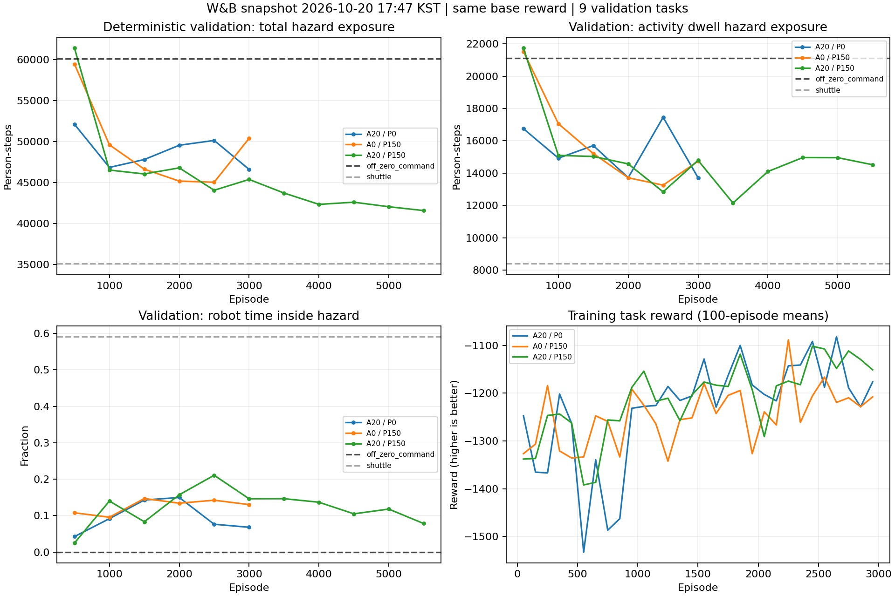

# W&B 재분석 — 2026-10-20 17:47 KST 조회

**[Certain] 이전 조회에서 보였던 Progress 단독의 우위는 유지되지 않았다. 두 최신 run 모두 3,000 검증이 완료됐고, 같은 episode에서는 혼합(A20/P150)이 가장 좋다. [Likely] 현재 데이터는 shaping 가중치의 단순 변경만으로 shuttle을 넘을 수 있다는 근거를 주지 못한다.**

이전 스냅샷 `../review_20261020/`를 보존하고 새로운 W&B history를 별도로 내려받았다. 실행 중인 실험의 config는 이전 스냅샷과 동일하다. 학습 설정·프로세스는 변경하지 않았다.

## 1. 수집 범위

| run | 링크 | 상태 | history 마지막 episode | 완료 검증 |
|---|---|---|---:|---:|
| Approach20 / Progress0 | [z44h9d77](https://wandb.ai/437snowcap-sungkyunkwan-university/adds-sac-ued6-261011ENV/runs/z44h9d77) | running | 3,309 | 3,000 |
| Approach0 / Progress150 | [4pr4wxci](https://wandb.ai/437snowcap-sungkyunkwan-university/adds-sac-ued6-261011ENV/runs/4pr4wxci) | running | 3,177 | 3,000 |
| Approach20 / Progress150 | [vsa06hsg](https://wandb.ai/437snowcap-sungkyunkwan-university/adds-sac-ued6-261011ENV/runs/vsa06hsg) | crashed | 5,930 | 5,500 |

학습이 진행된 마지막 episode와 평가가 완료된 episode를 구분해 비교했다.

모든 비교는 기존과 같은 200 m 지도 3개 × task seed 3개, 로봇 3대의 **고정 9-task deterministic 평가**다. OFF/shuttle 기준선이 모든 run과 평가 시점에서 같은지 검사했다. 최신 두 run은 3,000에서 optimizer update 수도 351,720 / 353,674로 비슷하다. 혼합은 같은 episode에서 322,060 update라 약 9–10% 적다.

각 reward 설정은 학습 반복 하나이며, checkpoint들을 독립적인 학습 seed로 보지 않는다. 검증 지역은 학습 지역과 같으며 새로운 지도 일반화 결과가 아니다. W&B `crashed` 상태로 혼합 run의 종료 원인이나 수치 발산을 추정하지 않는다.

## 2. 같은 학습량의 검증 위험 노출

`hazard_person_steps` 평균이며 **작을수록 좋다**. 단위는 person-step이다.

| episode | A20/P0 | A0/P150 | A20/P150 |
|---:|---:|---:|---:|
| 1,000 | 46,843 | 49,599 | **46,519** |
| 1,500 | 47,808 | 46,625 | **46,043** |
| 2,000 | 49,551 | **45,175** | 46,790 |
| 2,500 | 50,140 | 45,034 | **44,052** |
| 3,000 | 46,601 | 50,390 | **45,372** |
| 2,000/2,500/3,000 평균 | 48,764 | 46,866 | **45,405** |

**이전 판단의 수정:** 앞선 조회에서는 Progress 단독의 2,000 결과가 가장 좋아 계속 관찰할 우선순위를 높였다. 추가된 평가에서 2,500은 비슷했지만 3,000에서 악화했다. 따라서 지금은 Progress 단독을 가장 유망한 설정이라고 유지할 근거가 부족하다. 혼합은 1,000–3,000의 다섯 공통 평가 중 네 번 가장 좋고, 최근 세 평가 평균도 가장 좋다. 이는 관측된 run의 결과이며 혼합의 인과적·통계적 우위 확정은 아니다.

### Progress 단독

- 2,500→3,000 노출 **11.89% 증가**, 2,000→3,000 **11.54% 증가**.
- 2,500 대비 고정 task **6/9** 악화, 2,000 대비 **7/9** 악화. 한 task만의 이상치가 아니다.
- 체류 중 위험 노출은 13,256→14,739(**+11.19%**), 재유입은 219→245.3(**+12.02%**), followers/robot은 7.49→5.17(**-31.04%**).
- raw 노출 최저 checkpoint는 **2,500**이다. W&B에서 사용하는 task별 OFF 상대 개선율 평균 기준으로는 **2,000**이 최고(25.97%)이며 3,000은 17.54%다. 지표 정의에 따라 최적 checkpoint가 다르다.
- 3,000 한 번의 악화로 회복 불능이나 최종 실패를 단정하지 않는다. 정책 선택에는 최신 checkpoint보다 지정된 검증 기준의 best checkpoint를 사용한다.

### Approach 단독

- 2,500→3,000에 50,140→46,601로 반등했다.
- 그러나 1,000의 46,843 대비 개선은 **0.52%**에 불과하다. 초기에 도달한 수준으로 회복한 것으로 해석하는 편이 타당하며, 지속적인 성능 상승 증거는 약하다.
- 3,000은 raw 노출과 paired OFF 개선율 모두 해당 run의 최적 checkpoint지만, 1,000과의 작은 차이를 유의한 향상으로 주장하지 않는다.

## 3. shuttle과의 격차

공통 3,000 episode의 deterministic 평가:

| 지표 | A20/P0 | A0/P150 | A20/P150 | shuttle |
|---|---:|---:|---:|---:|
| 전체 위험 노출 | 46,601 | 50,390 | **45,372** | **35,103** |
| shuttle 대비 노출 초과 | +32.8% | +43.6% | +29.3% | — |
| 활동 체류 중 위험 노출 | 13,717 | 14,739 | 14,793 | **8,408** |
| 로봇 내부 체류 비율 | 6.8% | 13.0% | 14.6% | 59.1% |
| 평균 로봇 깊이(m) | 0.92 | 2.19 | 1.92 | 6.24 |
| 평균 로봇 속도(m/s) | 1.25 | 0.79 | 0.77 | 1.16 |
| followers/robot | 17.93 | 5.17 | 16.40 | 3.44 |
| 재유입(after clear) | 210.0 | 245.3 | 202.8 | 260.3 |

- Approach 단독은 shuttle보다 빠르고 추종자 수가 많아도 전체 성능이 낮다. 속도·추종자 수만 늘리는 보상이 해법이라고 볼 근거는 없다.
- Progress 단독은 혼합과 활동 체류 위험 노출이 거의 같지만(차이 약 54), 전체 노출은 약 5,018 많다. 두 정책의 전체 차이는 주로 활동 체류 외 상태의 노출이다. 재유입 증가가 함께 관측되지만 그 기여를 인과적으로 분리한 것은 아니다.
- 내부 접근·진입과 탈출의 순환, 군중을 어느 방향으로 얼마나 오래 유도하는지의 문제가 여전히 진단 후보다. 평균 속도 또는 깊이 하나로 원인을 설명할 수 없다.
- 현재 저장된 세 run 전체에서 가장 좋은 raw 노출은 혼합 **5,500의 41,572**다. shuttle보다 **18.43% 많으며**, shuttle과 같아지려면 그 checkpoint의 노출을 추가로 **15.56%** 줄여야 한다. 최신 단독 run과 학습량이 다르므로 공정한 동학습량 우열 비교는 아니다.
- Progress 단독 3,000은 OFF 60,123보다 16.19% 개선, shuttle보다 43.55% 노출이 많다. 개별 task에서는 OFF에 9/9 승리, shuttle에 1/9 승리한다. task별 상대 개선율 평균은 OFF 대비 17.54%, shuttle 대비 -47.66%이며, 전체 평균의 비율과는 다른 통계량이다.

## 4. 학습 보상과 SAC 지표

| 2,501–3,000 학습 episode 평균 | A20/P0 | A0/P150 | A20/P150 |
|---|---:|---:|---:|
| task reward | -1,172.78 | -1,206.38 | **-1,129.73** |
| raw 위험 노출 | 46,616 | 49,759 | **45,269** |

Progress 단독은 직전 500개 episode 대비 보상이 -1,212.23→-1,206.38로 조금 좋아졌지만, 고정 검증은 악화했다. `total_reward`는 shaping을 제외하며 음수가 덜 커질수록 좋다. 학습 task의 분포와 인원 정규화가 있어 학습 보상·raw 노출·고정 검증은 같은 지표가 아니다.

2,500–3,000 learner 평균:

| 지표 | A20/P0 | A0/P150 | A20/P150 |
|---|---:|---:|---:|
| alpha | 0.05 | 0.05 | 0.05 |
| entropy | 1.223 | 1.794 | 1.163 |
| Q loss | 32.76 | 24.29 | 27.06 |

세 run 모두 alpha 하한에 계속 묶여 있다. entropy 목표는 -3이며 Progress 단독은 최근 entropy가 가장 높다. 다만 낮은 Q loss나 높은 entropy만으로 성능 원인을 확정할 수 없다. stochastic policy 검증은 여전히 없어 확률적 행동과 결정적 행동의 성능 차이를 측정하지 못했다.

## 5. 권고

1. **3,500·4,000의 고정 평가를 확인하되, 추가 학습만으로 shuttle을 넘는다는 기대는 낮춘다.** Approach 단독도 한 checkpoint에서 반등했고 혼합도 과거 2,500→3,000 악화 후 재개선했으므로 단 한 번의 하락으로 중단을 권하지 않는다. 현재 실험은 그대로 두고 best checkpoint를 보존한다.
2. **Progress 단독을 우승 설정으로 고정하지 않는다.** 다음 ablation의 공통 기준은 현재 데이터상 혼합도 포함해야 한다. 실용적으로 혼합이 더 나았다는 것과 각 shaping 항의 순효과가 입증됐다는 것은 다르다.
3. **다음 구조 실험은 모드 조건부 actor를 우선 고려한다.** 같은 관측에서 off/guide 각각에 다른 waypoint·속도 분포를 제공하되, 확률 가중 Q 기댓값 학습은 유지한다. 기존 actor와 보상·alpha·평가 조건을 맞춰 비교한다. 성능 향상은 아직 가설이다.
4. **저비용 설정 실험은 alpha 하한 0.05→0.005만 변경한다.** actor 변경과 섞지 않고 별도 run에서 비교한다. 낮은 하한의 효과는 미확정이다.
5. **shuttle을 배우고 개선하는 BC→SAC를 별도 축으로 검토한다.** 현재 병목이 좋은 행동을 발견하지 못하는 것인지, 발견 후 유지·개선하지 못하는 것인지 분리할 수 있다. 아직 학습 실험을 수행한 것은 아니다.

## 재현 및 확인

`analyze.py`가 저장된 세 history를 분석한다. 중복 데이터의 공통 값 일치, 모든 기준선 동일성, task 수 9, 로컬 Progress per-task 로그와 W&B 평균 및 paired 상대 개선율 일치를 확인한다. 이전 config와 새 config의 값이 동일함도 비교했다. Approach history의 중복 episode 611행, 검증 2행, learner 401행은 별도 표본으로 세지 않았다.

```bash
MPLCONFIGDIR=/tmp/adds_review_mpl_20261020 python3 SAC_UED6_easy/docs/review_20261020_1747/analyze.py
```

`analysis.json`의 `progress_changes`에 개별 task의 2,000/2,500/3,000 노출 및 차이가 있다. `comparisons`에는 최근 공통 평가 평균과 best checkpoint 기준별 episode가 기록된다. fetch 스크립트 재실행은 새 데이터로 스냅샷을 덮어쓰므로 다음 조회는 별도 디렉터리를 권장한다.


