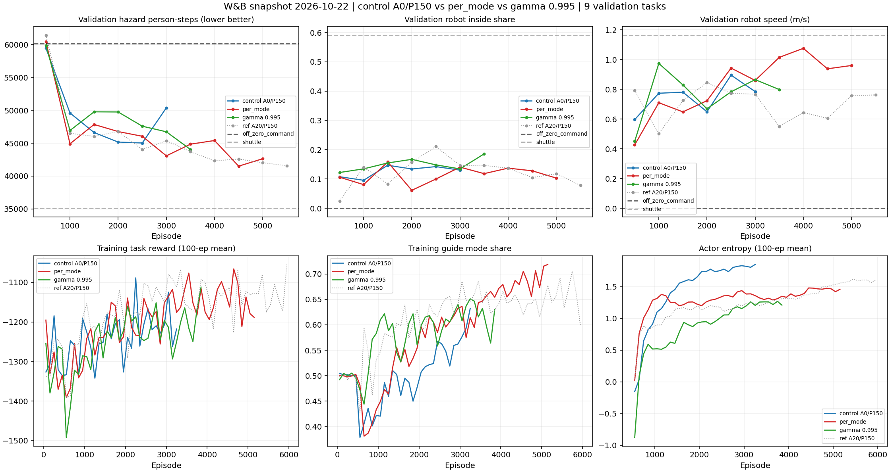

# W&B 분석 — 2026-10-22 (per_mode actor, γ=0.995)

**[Certain] 실행 중인 두 run은 이름과 달리 Approach=0이다. 대조군은 A0/P150 `4pr4wxci`이며, 각 run과 한 요인만 다르다.
[Likely] per_mode는 성능을 해치지 않고 행동을 뚜렷하게 바꿨지만(guide↑, followers↑, 깊이↓), 성능 개선은 잡음 범위 안이다.
γ=0.995는 아직 판단하기 이르다. 세 run 모두 shuttle에 18–30% 뒤진다.**

## 비교 조건

| 역할 | run | 이름 | 실제 차이 (W&B config 기준) | 마지막 episode |
|---|---|---|---|---:|
| 대조군 | 4pr4wxci | Reward_Approach0_Progress150 | A0/P150, shared, γ 0.99 | 3,211 (crashed) |
| per_mode | 5uhnt1nz | …Approach20_Progress150_permode | `ACTOR_CONT_HEADS=per_mode`만 | 5,154 (running, juna-B760M) |
| γ 0.995 | ul6kds66 | …Approach20_Progress150_Gamma0.995 | `GAMMA_*=0.995`만 | 3,814 (running, amrl-desktop) |
| 참고 | vsa06hsg | Reward_Approach20_Progress150 | A20/P150 (보상이 다름) | 5,930 |

- 대조군 commit 9c26b3bdc와 두 run의 commit 63cf7f0b7 사이 소스 차이는 `ACTOR_CONT_HEADS` 코드와 테스트뿐이다. `shared`는 HEAD와 수치 동일함을 확인했다(차이 ≤1e-5).
- 세 run 모두 `run/resumed_episode=0`(fresh). 학습 seed는 config별 1개, 검증은 200 m × 3 지역 × 3 seed = 9 task(학습 지역과 동일).
- 대조군과 A20/P0가 2026-10-20 09:15–09:18에 함께 `crashed`가 되고 1–2분 뒤 새 run이 시작됐다. [Likely] 수동 종료다.

## 1. 검증 (deterministic, `hazard_person_steps`, 낮을수록 좋음)

OFF 60,123 / shuttle 35,103 (모든 run·시점에서 동일함을 검사).

| episode | 대조군 | per_mode | γ 0.995 | 참고 A20/P150 |
|---:|---:|---:|---:|---:|
| 1,000 | 49,599 | 44,912 | 46,938 | 46,519 |
| 2,000 | 45,175 | 46,772 | 49,752 | 46,790 |
| 2,500 | 45,034 | 46,058 | 47,588 | 44,052 |
| 3,000 | 50,390 | 43,081 | 46,739 | 45,372 |
| 3,500 | — | 44,855 | 44,053 | 43,713 |
| 4,000 | — | 45,411 | — | 42,327 |
| 4,500 | — | **41,514** | — | 42,592 |
| 5,000 | — | 42,640 | — | 42,040 |

- 2,000–3,000 세 평가 평균: 대조군 46,866, per_mode 45,304(−3.3%), γ 48,026(+2.5%), 참고 45,405.
- 한 run 안에서 인접 checkpoint 간 표준편차가 1,400–3,000이다. run 간 차이(~1,500)가 이 범위 안이므로 우열을 확정할 수 없다.
- per_mode 4,500의 shuttle 대비 paired 감소율 −18.8%는 지금까지 본 값 중 가장 좋다. 다만 단일 checkpoint다.
- 3,500–5,000 평균은 per_mode 43,605, 참고 A20/P150 42,668이다. 보상이 다르므로 직접 비교하지 않는다.

## 2. 학습 분포 (500 episode 구간, 확률적 정책)

| 2,001–3,211 (n=1,211) | 대조군 | per_mode | γ 0.995 |
|---|---:|---:|---:|
| hazard person-steps | 48,388 | 47,311 (−1.0 SE) | 48,847 (+0.4 SE) |
| task reward | −1,206.8 | −1,180.5 (+1.5 SE) | −1,215.8 (−0.5 SE) |

SE는 episode 간 변동만 반영한다. 학습 seed 간 변동은 빠져 있어 실제 불확실성은 더 크다.

## 3. per_mode가 바꾼 행동 (2,501–3,000 학습 구간)

| | 대조군 | per_mode |
|---|---:|---:|
| guide 비율 | 0.55 | 0.61 (5,000 이후 0.72) |
| followers/robot | 6.5 | 9.0 (5,000 이후 12.7) |
| 위험구역 내부 비율 | 0.149 | 0.126 |
| 평균 깊이 (m) | 2.15 | 1.55 |
| 모드 전환율 | 0.42 | 0.35 |
| actor entropy | 1.79 | 1.38 |

- [Likely] 모드별 head 덕분에 guide가 더 유리해졌다. 로봇이 더 오래 guide하며 추종자를 더 모으고, 깊이 들어가지 않는다.
- 검증의 활동 체류 노출은 per_mode 4,500/5,000에서 12,003/12,361이다. 같은 시점 참고 A20/P150은 14,965/14,958로 약 17% 낮다. checkpoint 두 개뿐이라 [Speculation] 수준의 단서다.
- [Certain] off와 guide의 이동이 실제로 갈라졌는지는 로그로 확인할 수 없다. 모드별 이동·속도 지표가 없다.

## 4. γ 0.995

- Q 크기 ×1.78(−436 대 −245), Q loss ×2(53 대 25). horizon이 두 배가 되면서 생기는 예상된 변화다.
- 초반 학습이 느리다(entropy 낮음, 1,500–2,500 검증 열세). 3,500에서 44,053으로 따라잡는 중이다.
- **교란 요인:** PBRS shaping이 학습 γ를 그대로 쓴다(`sim/rewards.py:149-153`). Φ≤0이므로 F=gΦ'−Φ에는 매 step (1−g)|Φ'| 양의 항이 붙는다.
  - episode 합 shape_progress는 γ 0.99에서 ~150, 0.995에서 ~105다.
  - [Likely] γ 0.99에서 이 값의 약 60%가 이 drift 항이다.
  - 따라서 이 run은 "horizon 변경 + shaping 신호 크기 변경"이 섞인 비교다.

## 5. 권고

1. **run 이름과 config를 맞춘다.** 이번 두 run 이름의 "Approach20"은 사실과 다르다. 분석 기준은 W&B config로 했다.
2. **per_mode 판단에는 대조군 연장이 필요하다.** 대조군이 3,211에서 끝나 3,000 이후 비교 대상이 없다. A0/P150 shared를 다시 돌리거나, 가능하면 두 설정을 seed 2개 이상씩 돌린다.
3. **모드별 진단 지표를 추가한다.** 모드별 평균 이동 크기·속도, 그리고 검증 deterministic의 guide 비율이다. 이 지표가 없으면 per_mode의 효과가 "head 분리" 때문인지 "guide 비율 증가" 때문인지 구분할 수 없다.
4. **γ 0.995는 5,000까지 지켜본다.** 결과 해석 시 shaping drift 교란을 함께 고려한다.

## 재현

```bash
python3 fetch_history.py 5uhnt1nz ul6kds66 4pr4wxci   # W&B에서 다시 받기 (덮어씀)
MPLCONFIGDIR=/tmp/mpl python3 analyze.py               # 네트워크 없이 표·그림 재생성
```

vsa06hsg history는 `../review_20261020/`의 스냅샷을 쓴다.


